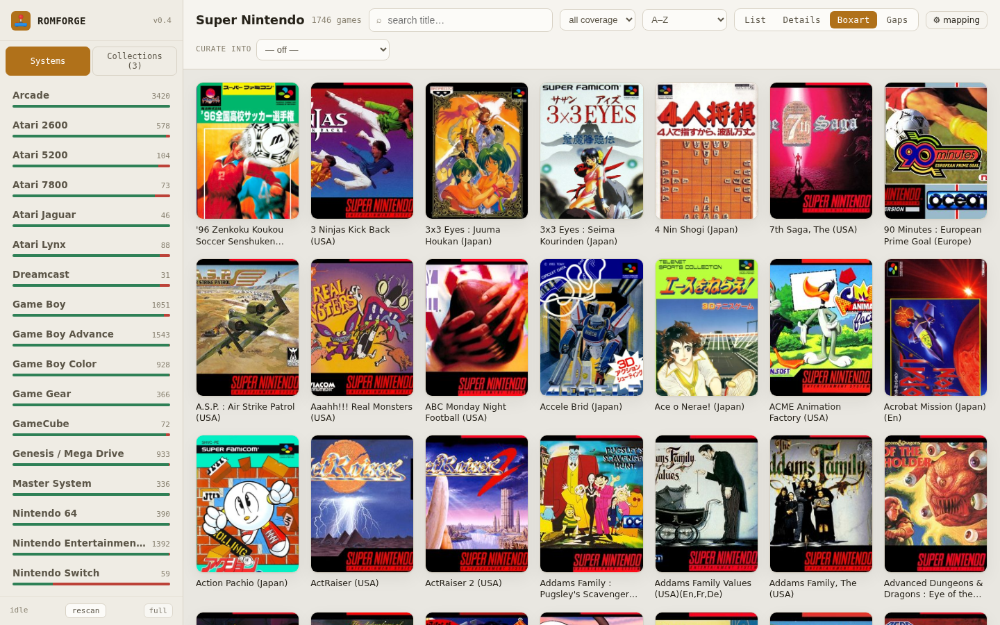
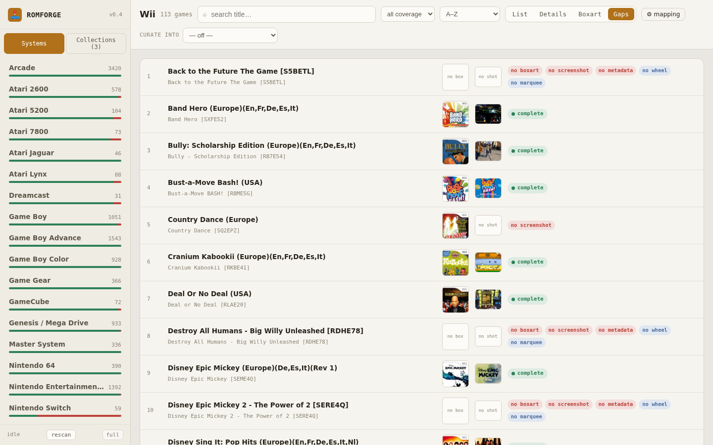
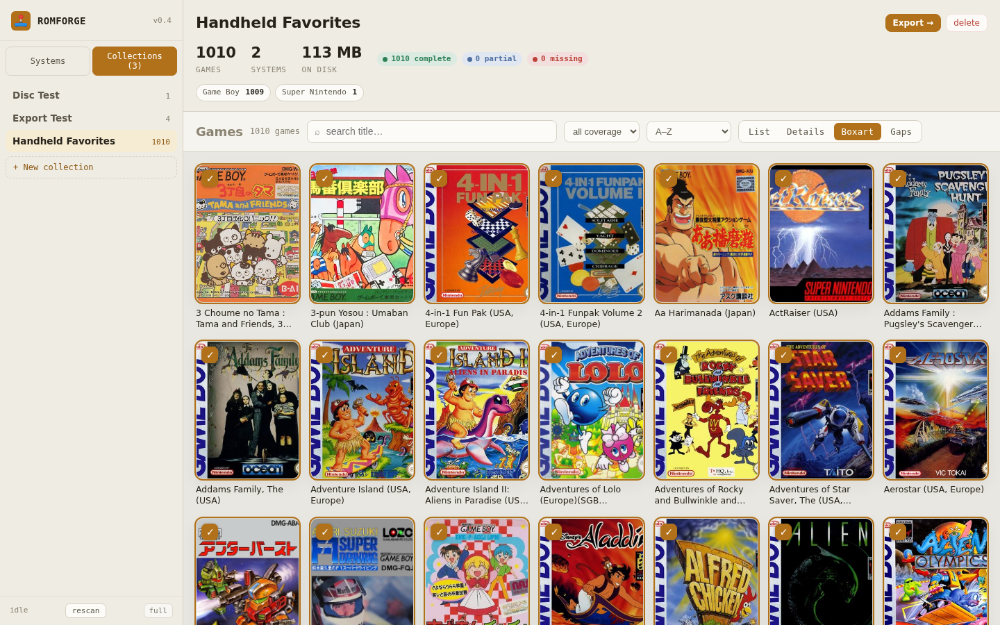
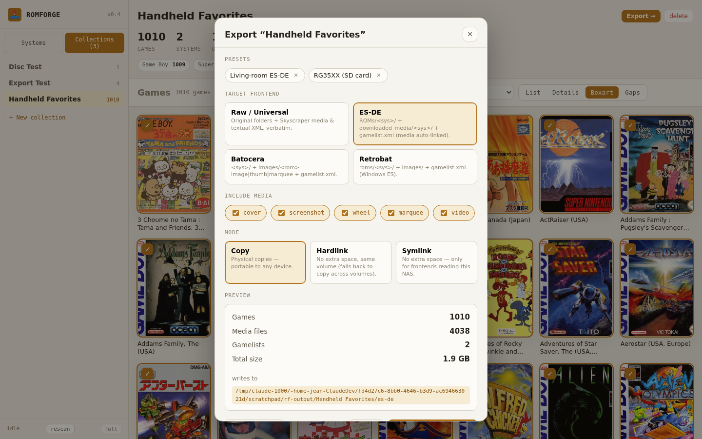
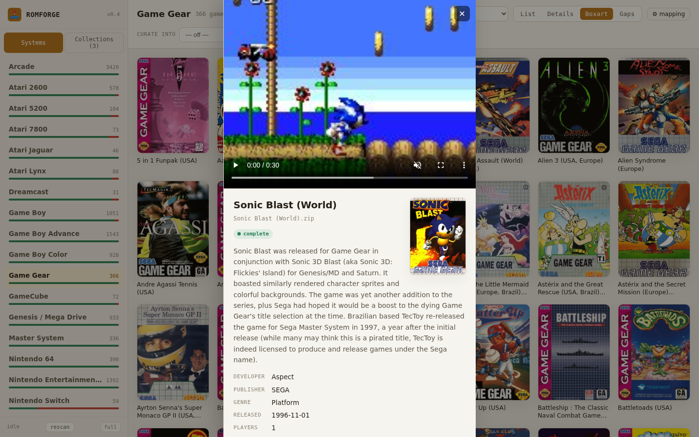

# ROMForge

Self-hosted web app to **browse a Skyscraper-scraped ROM library, cherry-pick
per-device collections, and export them packaged for any frontend** — ES-DE,
Batocera, Retrobat, or a raw copy. Runs as a single Docker container on a NAS
and never writes to your source library.



<table>
  <tr>
    <td></td>
    <td></td>
  </tr>
  <tr>
    <td></td>
    <td></td>
  </tr>
</table>

<sub>Gaps view (missing-asset flags) · a curated collection with stats · the per-frontend export dialog · the detail drawer with gameplay video.</sub>

## What works today

- **Per-system library**, one console at a time, with real ROM counts and a
  coverage bar per system.
- **Search** within a system, **filter** by coverage (complete / partial /
  missing), and **sort** (A–Z, Z–A, top-rated, least-complete).
- **Four views:** List, Details, Boxart grid, and **Gaps** — name + boxart +
  screenshot + exactly which assets are missing.
- **Game drawer** with full metadata, boxart, an asset checklist, and the
  **gameplay video** (streamed with seek support) when one exists — falling back
  to the screenshot otherwise.
- **On-the-fly thumbnails** (cached) so a 3,000-game boxart wall stays fast.
- **Read-only** over your library — the ROM root is mounted `:ro`; nothing is
  ever written back to it.

It understands the real-world quirks of a Skyscraper dump: folder-name variants
(`screenshot`/`screenshots`), disc games stored as `GameName [ID]/` subfolders,
incomplete `.part` downloads, and media named by region when the ROM is named by
id (normalized matching recovers the link).

## Run it on the NAS (Docker)

1. Edit `docker-compose.yml` — point the `/roms` volume at your library and
   `/output` at where collections should land:
   ```yaml
   volumes:
     - /volume1/Plex3/ROMs:/roms:ro
     - /volume1/Collections:/output
     - ./config:/config
   ```
2. Build and start:
   ```bash
   docker compose up -d --build
   ```
3. Open `http://<nas-ip>:8096`, then click **rescan** (bottom-left) to index the
   library. The first scan of a large set over the NAS takes a couple of minutes;
   after that it's cached in `/config/romforge.db`.

   Later rescans are **incremental** — only systems whose folders changed are
   re-read, so adding a few ROMs indexes in about a second. Use **full** (next to
   rescan) after a bulk re-scrape that overwrites media files in place.

## Configuration

All via environment variables (see `docker-compose.yml`):

| Variable | Default | Meaning |
| --- | --- | --- |
| `ROMFORGE_ROMS_ROOT` | `/roms` | Source library (mounted read-only) |
| `ROMFORGE_OUTPUT_ROOT` | `/output` | Where collections are written (Phase 3) |
| `ROMFORGE_CONFIG_DIR` | `/config` | SQLite index, thumbnail cache, settings |
| `ROMFORGE_PORT` | `8096` | HTTP port |

## Local development

```bash
# backend
cd backend
python -m venv .venv && . .venv/bin/activate
pip install -r requirements.txt
ROMFORGE_ROMS_ROOT=/path/to/ROMs uvicorn app.main:app --reload --port 8096

# one-off scan from the CLI (no web server needed)
python -m app.scanner /path/to/ROMs

# frontend (proxies /api to :8096)
cd frontend
npm install
npm run dev      # http://localhost:5173
npm run build    # compiles into ../backend/static for production
```

## Layout it expects

```
<ROMS_ROOT>/
  <System Name>/
    Game (USA).zip
    media/
      covers/      Game (USA).png
      screenshots/ Game (USA).png     # or screenshot/
      wheels/      Game (USA).png
      marquees/    Game (USA).png
      textual/     Game (USA).xml      # Skyscraper metadata
```

Disc systems may instead store each game as `Game [GAMEID]/GAMEID.wbfs`.

## Collections (Phase 2)

Curate device-specific sets without touching the library:

- Switch the sidebar to **Collections**, or pick a **curate into** target in the
  library toolbar — checkboxes then appear on every game.
- Tick individual games, or **Add all N** matching the current system + search +
  coverage filter in one click.
- The **Collections** page shows a collection's stats (game count, systems, size
  on disk, coverage breakdown) and its games in all four views; remove games or
  rename/delete the collection there.
- Membership is keyed by `(system, rom filename)`, so it **survives rescans**
  even though game rows are rebuilt each scan.

Deep links: `?system=snes&view=Gaps`, `?curate=<id>`,
`?mode=collections&collection=<id>`.

## Export (Phase 3)

Open a collection and hit **Export →** to physically build it for a target
frontend. Pick which media to include, see a **dry-run preview** (games, media
files, total size, destination), then export with a live progress bar.

Each target is written under `OUTPUT_ROOT/<collection>/<target>/`:

| Target | ROMs | Media | Metadata |
| --- | --- | --- | --- |
| **Raw** | `<System>/<rom>` | `<System>/media/{covers,screenshots,wheels,marquees,textual}/` | textual XML, verbatim |
| **ES-DE** | `ROMs/<sys>/<rom>` | `downloaded_media/<sys>/{covers,screenshots,marquees}/<stem>.png` | `ROMs/<sys>/gamelist.xml` (media auto-linked) |
| **Batocera** | `<sys>/<rom>` | `<sys>/images/<stem>-{image,thumb,marquee}.png` | `<sys>/gamelist.xml` |
| **Retrobat** | `roms/<sys>/<rom>` | `roms/<sys>/images/<stem>-…` | `roms/<sys>/gamelist.xml` |

Media includes **gameplay videos** when present (`video` toggle, on by default):
Raw passthrough, `downloaded_media/<sys>/videos/` for ES-DE, and
`<sys>/videos/<stem>-video.mp4` + a `<video>` gamelist tag for Batocera/Retrobat.

Notes:
- `<sys>` is translated from your folder name via the platform map
  (`Nintendo - Super Nintendo…` → `snes`).
- Media is remapped per target (Skyscraper `screenshot`→Batocera `image`,
  `cover`→`thumbnail`, `wheel`→`marquee`; `cover/screenshot/wheel`→ES-DE
  `covers/screenshots/marquees`).
- **Disc games** (`Game [ID]/GAME.wbfs`) are copied as whole folders.
- **Copy / hardlink / symlink** modes: copy is portable; hardlink and symlink
  use near-zero extra space for frontends reading the same NAS (hardlink falls
  back to copy across volumes).
- Resume-friendly (existing same-size files are skipped) and drops a
  `romforge-manifest.json` at the export root.
- **Presets** save a target + media + mode combo (e.g. "RG35XX") for one-click
  repeat exports.

## Editing the platform map

Each system's frontend ids (`es`/`batocera`/`retrobat`) and display name come
from a built-in map. To fix an unmapped system or use a custom id, open a system
in the library and click **⚙ mapping** — overrides are stored in the DB and
survive rescans. Leave a field blank to fall back to the built-in default.

## Roadmap

ROMForge does the full job it was scoped for: browse → flag gaps → curate →
export. Possible future work: multiple ROM sources, editable media-type remap,
and resumable-across-restart export jobs.

## Stack

FastAPI + SQLite + Pillow (backend) · React + Vite (frontend) · single Docker
image serving both.
